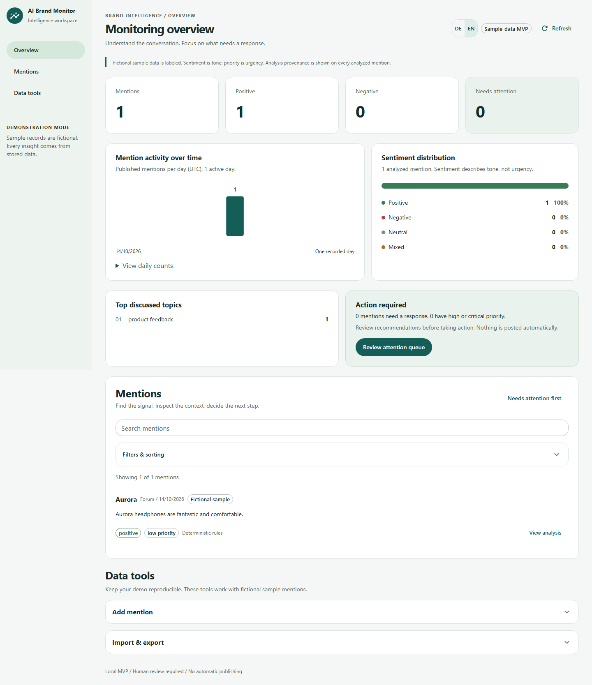
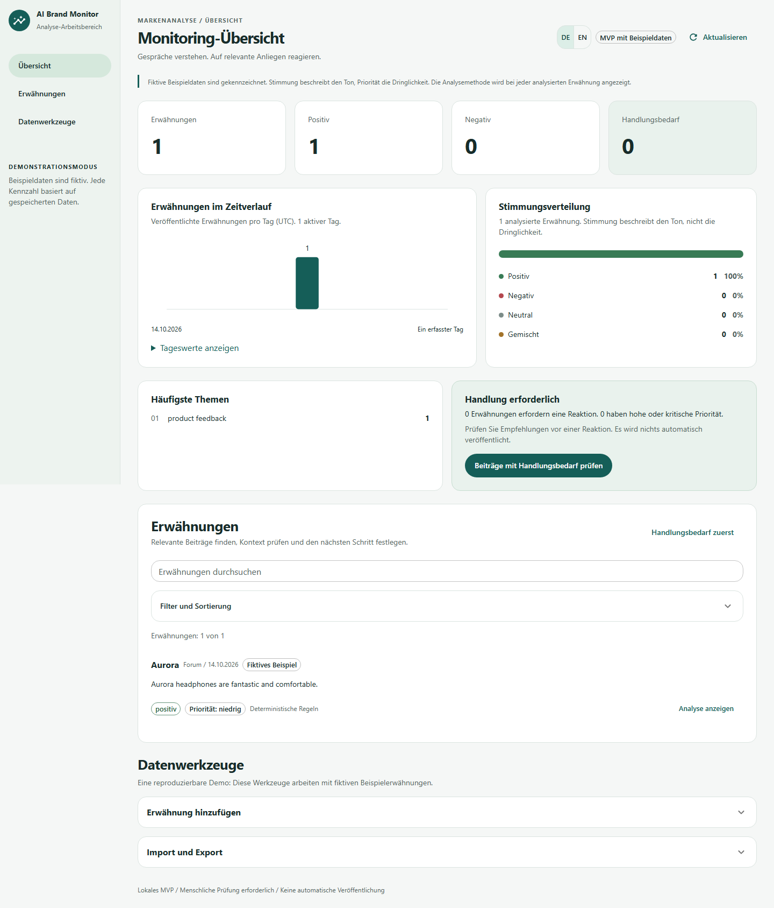
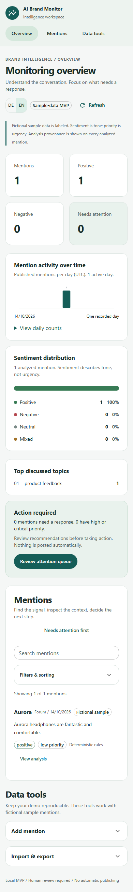
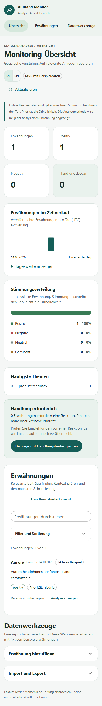
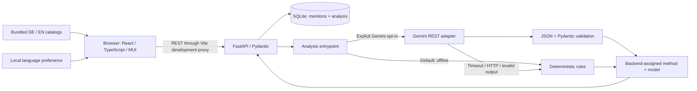

<h1 align="center">AI Brand Monitor</h1>
<p align="center"><strong>A transparent brand-intelligence workspace for turning mentions into reviewable marketing and support decisions.</strong></p>
<p align="center">React · FastAPI · SQLite · Optional Gemini · Deutsch / English</p>
<p align="center"><a href="#features">Features</a> · <a href="#architecture">Architecture</a> · <a href="#local-development-windows">Quick start</a> · <a href="#testing-and-verified-evidence">Testing</a> · <a href="docs/presentation/DEMO_SCRIPT.md">Demo guide</a> · <a href="ROADMAP.md">Roadmap</a></p>



**An interview-focused portfolio MVP, not a production social-listening platform.** Every dashboard value is calculated from stored mentions. Sample records are explicitly fictional. The screenshots show actual local browser runs with isolated, deterministic test data; no fabricated engagement metrics or social-platform integrations are implied.

<details>
<summary>German interface and mobile views</summary>



| English mobile | German mobile |
| --- | --- |
|  |  |

These dashboard captures were refreshed from the passing isolated release suite. The switch also selects saved bilingual analysis wording or a clearly labeled local description of legacy classification fields. Original mention content, topic/platform values and the expandable original analysis remain unchanged. Before/after design-history assets are retained separately for the presentation.

</details>

## Features

- **Triage-first overview:** stored mention totals, positive/negative counts, action-required overview, sentiment proportions, UTC daily activity and discussed topics.
- **Find and inspect:** combined search, sentiment, platform, topic, priority, attention and date filters; chronological or priority sorting; expandable context and recommendations.
- **Transparent analysis:** relevance, sentiment, topic, action requirement and urgency are separate fields. Provenance distinguishes `llm`, `deterministic` and supported `human` records; human authoring is not an implemented workflow.
- **Reproducible data tools:** create fictional mentions, import validated JSON batches, download all stored records as JSON/CSV, and seed/reset local fictional data safely.
- **DE/EN interface:** browser-language detection, accessible switch, local preference persistence and locale-aware date/number formatting. Switching preserves the active UI state; a page reload does not persist drafts or filters.
- **Responsive Material Design 3 inspired presentation:** existing MUI components, tonal surfaces, restrained hierarchy, keyboard navigation and labeled status indicators.
- **Offline-first analysis:** deterministic English-language rules work without a provider; optional server-side Gemini output is validated with Pydantic and falls back on failure.

## Architecture



### Stack and rationale

| Layer | Technology | Why it fits this MVP |
| --- | --- | --- |
| Interface | React 18, TypeScript, MUI 6 | Typed, modular components and an accessible component foundation |
| Build | Vite 6.4.4 | Fast local iteration; patched toolchain without an unnecessary latest-major migration |
| Localization | i18next + react-i18next | Explicit catalogs, plural rules and reactive language changes without remounting state |
| API | Python 3.12+, FastAPI, Pydantic | Clear request contracts and validation of both user and model input |
| Persistence | Standard-library SQLite | Small reproducible local dataset with no external database service |
| Optional AI | Gemini REST via HTTPX | Backend-only credentials, validated output and explicit provider choice |
| Verification | pytest, Vitest 4, Playwright, axe-core | Business/API regression checks plus isolated desktop/mobile workflows |

Client-side aggregation is intentional for the small MVP. Full-list retrieval, synchronous inference and SQLite are not presented as a production scaling architecture. See [architecture](docs/architecture/ARCHITECTURE.md) and [ADRs](docs/decisions/).

## AI analysis pipeline

1. FastAPI validates a fictional mention or import batch.
2. The analysis entrypoint chooses `AI_PROVIDER`.
3. Deterministic mode applies transparent English-language keyword rules.
4. Gemini mode sends mention content to the configured endpoint with a server-side key. Content is declared untrusted data in the prompt.
5. The response must be a JSON object accepted by `MentionAnalysis`. The backend assigns `method=llm` and the configured model name; model-provided provenance is not authoritative.
6. Timeout, transport/HTTP failures, invalid configuration or invalid model responses trigger labeled deterministic fallback. Logs contain safe categories/status, not credentials or provider bodies.
7. Analysis is stored with the mention and displayed with human-review guidance.

**Sentiment is tone; priority is urgency.** An adverse sentiment alone is not automatically an urgent issue. Recommendations are suggestions: the application never posts responses automatically.

### What has actually been verified

One previous controlled request to `gemini-3.1-flash-lite` returned HTTP 200 in **6.86 seconds**, valid JSON and Pydantic output with `method=llm`. This establishes a service-level integration on one fictional positive example, not accuracy, availability or end-to-end live-provider browser coverage. Browser tests are deterministic; no new Gemini calls were made for localization or README work.

Owner-confirmed project Free Tier limits at that verification: 15 RPM, 250,000 input TPM and 500 RPD. Provider eligibility and quotas can change; check your own project. Never enable billing for this demo. [Secure Gemini setup](docs/development/GEMINI_LOCAL_SETUP.md).

## Local development (Windows)

Prerequisites: Git, **Python 3.12+**, **Node 22+**, npm. This workstation was verified with Python 3.14.3 and Node 24.14.0. The committed frontend lockfile pins resolved dependencies; use `npm ci`. The completed MVP is prepared on `feat/project-foundation` in [PR #1](https://github.com/Duy-Phan96/ai-brand-monitor/pull/1). Use that branch until the owner merges it into main. See [release preparation](docs/releases/RELEASE_PREPARATION.md) for exact validation and remaining acceptance work.

```powershell
git clone https://github.com/Duy-Phan96/ai-brand-monitor.git
Set-Location ai-brand-monitor
git switch feat/project-foundation
# Create local configuration only if it does not already exist.
if (-not (Test-Path .env)) { Copy-Item .env.example .env }

Set-Location backend
python -m venv .venv
.\.venv\Scripts\python.exe -m pip install -e ".[dev]"

Set-Location ..\frontend
npm ci
```

Start the backend in one PowerShell terminal:

```powershell
Set-Location 'C:\path\to\ai-brand-monitor\backend'
.\.venv\Scripts\python.exe -m uvicorn app.main:app --reload
```

Start the frontend in another:

```powershell
Set-Location 'C:\path\to\ai-brand-monitor\frontend'
npm run dev
```

Open `http://localhost:5173` and `http://localhost:8000/docs`. The Windows paths above are placeholders; substitute your clone location. Backend virtual-environment activation is not required with these commands. Stop each process with Ctrl+C.

### Fictional demo data

From `backend/`:

```powershell
.\.venv\Scripts\python.exe -m scripts.seed_demo
```

This seeds five repository-provided examples only into an empty database; existing data remains untouched. The default database path is relative to the backend working directory.

For an **intentional reset** of fictional rows:

```powershell
.\.venv\Scripts\python.exe -m scripts.reset_demo --confirm
```

Reset replaces existing sample rows and refuses when non-sample rows exist. It is not a database migration tool. Examples have `is_sample=true` and missing source URLs rather than invented authentic-looking links.

### Input and JSON transfer contract

Both create/import endpoints reject non-sample records with HTTP 422; they never relabel them. `is_sample` must be a JSON boolean and defaults to true when omitted. Brand/content/platform are trimmed, must contain non-whitespace text and reject NUL/malformed Unicode. Publication timestamps must be ISO 8601 with an explicit timezone (`Z` or an offset) and normalize to UTC before storage. Epoch/date-only/naive timestamps are rejected. Existing rows are preserved without guessing their timezone.

JSON export retains IDs and nested analysis for inspection. Upload the unchanged nonempty export within the existing 1–500-record / 1 MB browser limits: import discards `id`/`analysis`, validates the remaining fields, recomputes analysis through the selected provider and allocates database IDs. Other unknown fields are rejected. It appends duplicates, not updates; this is not backup/analysis restoration. Invalid batches insert nothing. Empty/oversized exports cannot be imported as one batch. CSV is export-only. In Gemini mode imports can trigger sequential real inference; use deterministic mode for offline acceptance.

[Contract decision](docs/decisions/0012-safe-sample-input-contract.md) · [P1 verification](docs/testing/P1_FIX_VERIFICATION.md)

## Configuration

The root `.env` is ignored by Git. Existing process variables take precedence over dotenv values. Never paste a key into documentation, screenshots, issues or chat.

| Setting | Default / local choice | Behavior |
| --- | --- | --- |
| `AI_PROVIDER` | Example: `deterministic` | `gemini` explicitly opts into external inference |
| `AI_MODEL` | `gemini-3.1-flash-lite` | Selected provider model; availability is account-dependent |
| `AI_API_KEY` | Empty in the example | Manually enter your existing key locally only |
| `AI_TIMEOUT_SECONDS` | `45` | Positive finite HTTPX per-phase timeout; not a total wall-clock deadline |
| `BRAND_MONITOR_DB_PATH` | `data/ai_brand_monitor.db` | SQLite path, relative to the backend working directory |
| `APP_ENV` | `development` | Example environment designation; not a production security control |
| `VITE_API_PROXY_TARGET` | `http://localhost:8000` | Optional development/test proxy target |
| `PYTHON_DOTENV_DISABLED` | Unset for development | Tests set `1` to prevent local credential/config loading |

The UI preference key is `ai-brand-monitor.language` in local storage. Valid values are `de` and `en`; restricted storage degrades to in-memory switching. No translation service is called. Mention content and platform/topic values remain source data. Analysis prose selects saved `localized_text.de/en` when available; rules/legacy analyses get an explicitly labeled localized classification description, not a claimed translation of arbitrary old free text. Original scalar analysis remains inspectable in an untranslated disclosure. Switching makes no API call or database write. New Gemini generation requests both variants in one response, with a 1600-token output ceiling; no new provider or repeated language-switch inference is used. [ADR 0013](docs/decisions/0013-bilingual-analysis-text.md).

## Testing and verified evidence

Backend, from `backend/`:

```powershell
.\.venv\Scripts\python.exe -m pytest -q
.\.venv\Scripts\python.exe -m pip check
```

Frontend, from `frontend/`:

```powershell
npm test
npm run build
npx playwright install chromium
npm run test:e2e
npm audit
```

| Local check | Latest result |
| --- | --- |
| Backend pytest | 122 passed; one existing Starlette/httpx deprecation warning |
| Frontend Vitest | 18 passed, including analysis wording selection/legacy descriptions, catalog parity and localization |
| Production build | Passed |
| Playwright | 34 desktop/mobile cases passed, including zero-request analysis-language switching, bilingual state/persistence, native validation, JSON reimport and UTC workflows |
| Responsive layout | Checked at 320, 390, 768 and 1440px in both languages |
| axe-core | No WCAG 2.0/2.1 A/AA violations in tested expanded states |
| npm audit | 0 reported vulnerabilities |

The table records local validation. GitHub Actions separately verifies backend, frontend/audit, Chromium E2E and release hygiene against the current PR head; inspect the exact head checks before merging, rather than inferring CI success from local results. Automated accessibility scans do not establish complete WCAG conformance.

Pytest ignores live dotenv configuration, clears credentials and blocks external transport. Playwright starts separate servers on 8011/5174, allocates isolated SQLite storage, uses deterministic AI, disables service workers and rejects unexpected application traffic. It refuses to reuse your existing dev servers. Playwright selects a local backend `.venv` interpreter on Windows/Linux when present and otherwise uses `python` from PATH, including CI.

[Analysis-language QA](docs/testing/ANALYSIS_LANGUAGE_QA.md) · [Testing strategy](docs/testing/TEST_STRATEGY.md) · [Bilingual QA](docs/testing/LOCALIZATION_QA.md) · [Browser QA](docs/testing/BROWSER_E2E_RESULTS.md) · [Dependency audit](docs/testing/DEPENDENCY_SECURITY_AUDIT.md)

## Security and privacy

- Provider keys remain server-side; Gemini receives a key only in its configured endpoint's request header.
- Imported data and model output are untrusted; request/output validation and parameterized SQLite operations are used.
- Create and import accept fictional sample records only, with batch limits on import; the frontend also applies a file-size limit. A robust server-side request-byte limit is still future work.
- CSV export neutralizes leading spreadsheet-formula characters.
- No automated retries or publishing. Provider use requires human review, account/quota checks and approved fictional test content.
- The MVP has no authentication, authorization or production hardening. Keep development servers local; do not expose them as a production service.
- Zero npm findings is a dependency snapshot, not a comprehensive security certification. Test guards are not an OS-level network sandbox.

## Project structure

```text
ai-brand-monitor/
├── backend/
│   ├── app/                 # API, schemas, SQLite access and analysis services
│   ├── data/                # Fictional sample dataset
│   ├── scripts/             # Seed/reset and offline evaluation
│   └── tests/               # Offline API/unit tests and isolated E2E wrapper
├── frontend/
│   ├── src/                 # Theme, dashboard, filters, details and data tools
│   │   └── i18n/            # Locale selection, formatting and bundled de/en catalogs
│   ├── e2e/                 # Browser workflows and localization regressions
│   └── package-lock.json    # Reproducible resolved frontend dependencies
├── docs/
│   ├── architecture/        # System design
│   ├── decisions/           # ADRs and trade-offs
│   ├── development/         # Actual development journal and local Gemini guide
│   ├── testing/             # Executed checks, findings and limitations
│   └── presentation/        # Demo/interview material and verified screenshots
├── .env.example             # Credential-free configuration example
├── AGENTS.md                # Repository guidance
└── ROADMAP.md
```

## Scope and roadmap

Implemented: local monitoring, transparent classification, persisted fictional inputs, triage, filtering, transfer tools, bilingual UI and isolated browser verification. Not implemented: authentic live social ingestion, executive summaries, automatic responses, user accounts, distributed processing or production deployment.

Personal product-owner acceptance on dedicated fictional data remains pending, followed by the final presentation. Publishing the PR does not claim manual acceptance. Remaining quality checks include screen-reader/zoom and real-device checks, additional browser engines, broader classification evaluation, large-dataset/server pagination decisions and review of the current PR checks before merge. Dark mode remains future work. See [ROADMAP.md](ROADMAP.md) for the complete evidence-based plan.

## Development approach and interview material

AI assistance was used for implementation, documentation and test development, with actual decisions, failures and corrections recorded in the [development journal](docs/development/DEVELOPMENT_JOURNAL.md). Human requirements and verified evidence govern the scope. AI-assisted coding is separate from runtime model inference; deterministic results are never presented as Gemini outputs.

- [Demo script](docs/presentation/DEMO_SCRIPT.md)
- [Technical walkthrough](docs/presentation/TECHNICAL_WALKTHROUGH.md)
- [Slide deck plan](docs/presentation/SLIDE_DECK_PLAN.md)
- [Interview Q&A](docs/presentation/INTERVIEW_QA.md)
- [AI development process](docs/presentation/AI_DEVELOPMENT_PROCESS.md)
- [Presentation guide](docs/presentation/PRESENTATION_GUIDE.md)
- [Contribution guidance](CONTRIBUTING.md)

PowerPoint, PDF, natural German speaker notes and a reproducible live demo remain final presentation deliverables; this README does not claim that those exports already exist. No LICENSE file is currently included; a publication license still needs an explicit project-owner decision.
