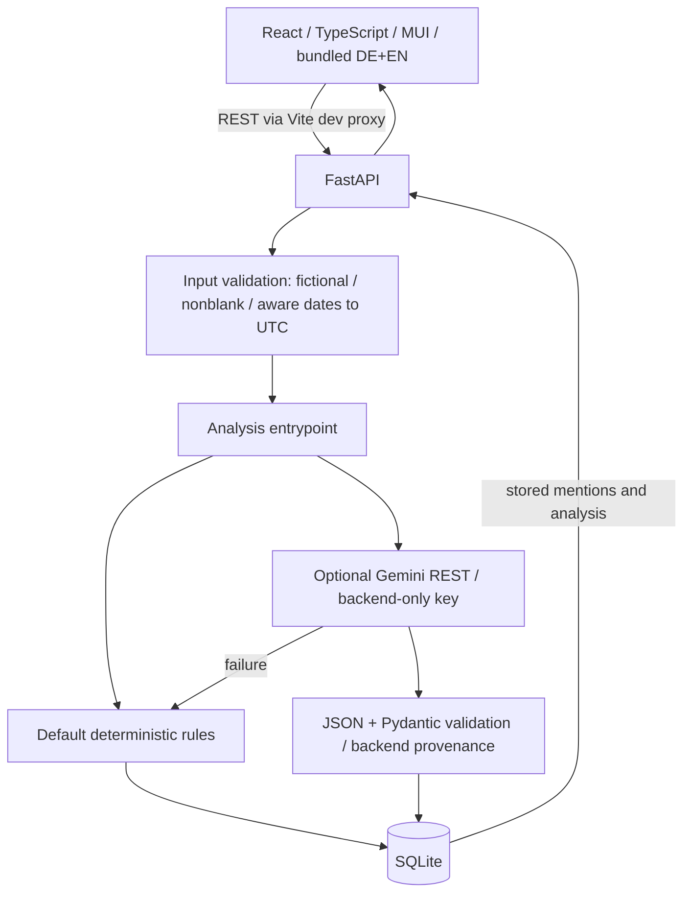

# System Architecture

Current implementation, updated 2026-10-20. Fictional data only; external social-platform connectors are out of scope.

## Responsibilities and trade-offs

The frontend implements overview statistics, UTC activity, topic/sentiment distribution, combined filters/sorting, detail/provenance disclosure, fictional entry and transfer. Theme, overview, list, filters, form, transfer and localization are separate modules; App owns fetched/filter/loading state. Local storage persists language only. Styling is MD3-inspired, not strict Material 3 certification.

FastAPI owns request validation, selected-provider analysis and persistence. `MentionFields` supports stored reads, including legacy rows. `MentionCreate` enforces fictional-only input, trims required text, rejects blank/malformed content and normalizes explicitly timezone-aware dates to UTC. `MentionImport` discards exported `id`/`analysis` before the same validation; other unknown fields remain prohibited. See ADR 0012.

SQLite suits a small single-instance MVP. SQL is parameterized and analysis stored as validated JSON. Database-generated IDs identify new inserts. Import validates the entire batch and computes all analyses before one transactional insertion. Existing data is not migrated or silently relabeled. Migrations, normalized analysis tables, pagination and production scaling remain future work.

Client-side list filters do not change global KPIs; irrelevant records also contribute to global counts. Activity shows active UTC dates, not a continuous-growth or forecast metric. Full-list retrieval and synchronous inference are deliberately limited to the small demo.

## API

- `GET /api/health`: liveness, not database/provider readiness.
- `GET /api/mentions`: stored records newest first, without inference on read.
- `GET /api/mentions/{id}`: stored record or 404.
- `POST /api/mentions`: validate fictional input, analyse, persist and return 201; invalid input returns 422.
- `POST /api/mentions/import`: validate 1–500 fictional records, discard export identity/analysis, reanalyse and append atomically.
- `GET /api/mentions/export?format=json|csv`: stored records and provenance. JSON is accepted by import within existing batch/file limits; CSV is export-only.

Errors expose location/type/message without echoing raw input. Import appends duplicates; it is not a backup restore/upsert. Empty exports are not valid nonempty import batches. Browser uploads have a 1 MB ceiling; the API still lacks a request-byte ceiling.

## Analysis and provenance

Default deterministic analysis uses limited English rules and 240-character summary excerpts. Explicit Gemini mode uses a fixed HTTPS endpoint, backend-only key, JSON parsing and Pydantic validation; backend code owns method/model. Treating content as untrusted in a prompt does not prove injection resistance or semantic correctness.

The configurable timeout defaults to 45 positive finite seconds per HTTPX phase, not a total deadline. No retries or redirects. Timeout/status/transport/invalid-output/configuration failures produce labeled deterministic fallback; logs contain safe categories/status. Creation/import use the configured provider; seed/reset always use rules. A historical successful service request is recorded in the journal; offline tests do not establish current live availability or live browser inference.

## Analysis language

An optional `localized_text` pair inside existing analysis JSON stores validated de/en summaries, explanations and recommendations. New Gemini prompts request both variants in one response (1600 output-token ceiling). Backend-owned classification/provenance remain unchanged. Optionality allows legacy rows and missing-pair provider responses; malformed supplied pairs use normal provider fallback.

The frontend selects stored wording by the active language. Rules and records without a pair use explicitly labeled local descriptions of classification fields and general/known-rule review guidance. This is not a faithful translation of old free text; unchanged scalar originals remain in an untranslated disclosure. Original mention content/topics/platforms are not translated. No HTTP, database write or inference on switching; no second translation API. Existing rows are never backfilled automatically. JSON retains the pair; CSV retains original flat fields. See ADR 0013 and ANALYSIS_LANGUAGE_QA.md.

## Data lifecycle and security

Seed inserts five fictional examples only into an empty database. Explicit CLI reset replaces all fictional rows, including manually created ones, and refuses legacy non-sample rows. No destructive reset endpoint exists in the normal app. Existing timezone-free rows remain readable without guessing their timezone; importing them requires an explicitly supplied timezone.

There is no authentication, rate limiting, background queue or production deployment hardening. Keep servers local. React renders source/model text as text; URLs require HTTP(S); CSV mitigates basic formula injection. These are limited safeguards, not production security certification.

## Release and CI boundary
The feature branch/PR, rather than deployed infrastructure, is the release artifact. CI runs Python 3.12 backend checks, Node 22 lockfile-based build/tests/audit, isolated Linux Chromium E2E and release hygiene/history signature checks. Playwright chooses an available local Windows/Linux virtualenv interpreter or PATH Python. No production deployment is configured. Current merge evidence is the checks attached to the exact PR head; recommendations and local results are in `docs/releases/RELEASE_PREPARATION.md`.

## Test boundaries

Pytest disables dotenv before imports, clears inherited credentials, forces rules and blocks real HTTPX/socket connections with a narrow Windows socketpair IPC exception. Every test receives temporary storage by default; provider tests use mocks.

Playwright starts dedicated loopback servers, refuses reuse, uses temporary SQLite and a wrapper-only reset, blocks provider traffic and restricts browser HTTP/WebSockets. This is test policy, not an OS sandbox. Chromium emulation/axe do not replace real-device, other-engine or full accessibility acceptance. Current results: [analysis-language QA](../testing/ANALYSIS_LANGUAGE_QA.md); earlier P1 results remain a dated record.
